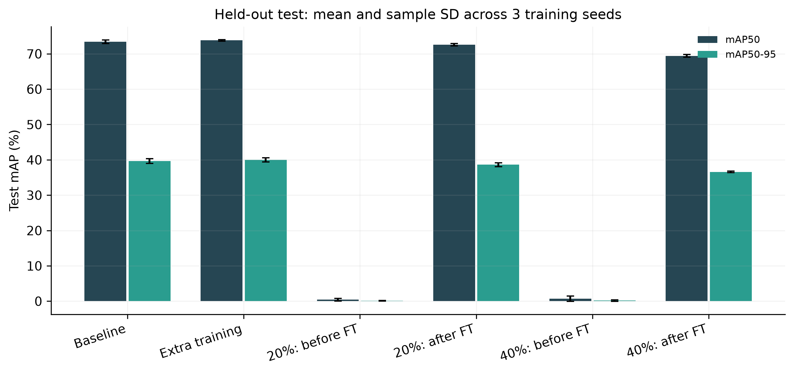
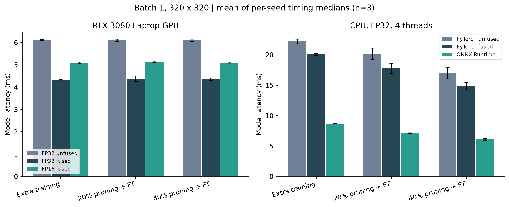

# NEU-DET钢材表面缺陷检测与通道剪枝

在NEU-DET上训练YOLOv8n，比较两档通道剪枝在微调前后的检测精度、参数量和推理耗时。未剪枝模型追加相同轮数的训练，作为训练预算对照。

## 实验结果

使用3个训练种子，完成12次训练，共255轮。下表为270张固定测试图片上的均值与样本标准差。

<!-- measured-results:start -->
| 条件 | mAP50 (%) | mAP50-95 (%) | 参数量 (M) | MAC (G) |
| --- | ---: | ---: | ---: | ---: |
| 未剪枝基线 | 73.40 ± 0.50 | 39.64 ± 0.69 | 3.012 | 1.018 |
| 未剪枝继续训练 | 73.82 ± 0.20 | 39.97 ± 0.58 | 3.012 | 1.018 |
| 轻度剪枝，未微调 | 0.42 ± 0.37 | 0.10 ± 0.10 | 1.945 | 0.663 |
| 轻度剪枝，微调15轮 | 72.59 ± 0.36 | 38.63 ± 0.53 | 1.945 | 0.663 |
| 中度剪枝，未微调 | 0.71 ± 0.76 | 0.18 ± 0.22 | 1.252 | 0.507 |
| 中度剪枝，微调15轮 | 69.42 ± 0.38 | 36.59 ± 0.21 | 1.252 | 0.507 |


<!-- measured-results:end -->

轻度剪枝的参数量减少35.43%，MAC减少34.89%，相对等预算对照的mAP50-95下降1.34个百分点。GPU单图推理未观察到稳定的剪枝加速；使用ONNX Runtime在CPU执行时，模型计算耗时由8.68 ms降到7.13 ms。耗时来自同一台电脑，输入320×320、batch 1，不含读盘、预处理、NMS和绘图。

<!-- single-pc-followup:start -->

<!-- single-pc-followup:end -->

## 数据与设置

- NEU-DET共1,800张图片，6类缺陷；原始XML包含4,189个框，框架去除3条重复标签后为4,186个有效框。
- 训练、验证和测试分别为1,260、270、270张，划分种子2026；完全重复的图片分在同一集合。
- 训练种子42、43、44，基线40轮，对照继续训练和剪枝后微调各15轮。
- 通道剪枝配置为20%和40%，采用DepGraph及分组L2重要性，保护检测输出头，通道宽度按8对齐。
- 自建划分缺少工件编号；这些结果不能与不同划分的论文直接排名，也不代表真实产线或RK3568 NPU性能。

## 环境准备

本机使用Windows、Python 3.12.5、PyTorch 2.5.1+cu121、torchvision 0.20.1+cu121和RTX 3080 Laptop GPU（8 GB）。检测源码固定为Ultralytics 8.0.90对应提交，Torch-Pruning为1.6.1。其他依赖见`requirements.txt`。

在英文路径的项目目录中打开PowerShell。先安装PyTorch，再创建环境并安装其余依赖：

```powershell
python -m pip install torch==2.5.1 torchvision==0.20.1 --index-url https://download.pytorch.org/whl/cu121
python -m venv --without-pip --system-site-packages .venv
python -m pip --python ".\.venv\Scripts\python.exe" install -r requirements.txt
```

仓库中的`results`是已完成实验的记录。重新运行前，在新的工作副本中将其改名保留，再准备数据与固定源码：

```powershell
Rename-Item -LiteralPath .\results -NewName results_reference
& .\setup.ps1
```

`setup.ps1`下载数据、预训练权重和固定源码，生成数据划分并检查环境。没有上传原始图片、训练权重或虚拟环境；在另一台机器上仍需核对驱动与依赖兼容性。

## 训练与评价

```powershell
& ".\.venv\Scripts\python.exe" experiment.py --mode smoke
& ".\.venv\Scripts\python.exe" experiment.py --mode matrix --epochs 40 --finetune-epochs 15 --batch 32 --seeds 42 43 44
& ".\.venv\Scripts\python.exe" evaluate.py --seeds 42 43 44
& ".\.venv\Scripts\python.exe" plot.py
```

小规模smoke只检查训练、剪枝和保存流程。正式检查点按验证集选择，最终指标统一在320×320、FP32条件下计算；训练内部的FP16验证曲线与最终评价条件不同。完成过的训练目录和冻结的补充方案不会被静默覆盖。

## CPU图片检测

完成正式训练后，导出并核对ONNX模型，再处理验证图片：

```powershell
& ".\.venv\Scripts\python.exe" setup_onnx.py
& ".\.venv\Scripts\python.exe" onnx_check.py
& ".\.venv\Scripts\python.exe" onnx_predict.py --source ".\data\yolo\images\val" --limit 6
```

检测结果保存在`predictions/onnx_cpu`。ONNX模型固定batch 1、320×320、FP32，使用CPUExecutionProvider。融合、FP16和BN统计校准的条件见[补充实验说明](docs/单机补充验证.md)。

## 文件结构

| 文件 | 用途 |
| --- | --- |
| `prepare_data.py` | 标注检查、重复分组与数据划分 |
| `pruning.py` | C2f等价改写和结构化剪枝 |
| `training.py`、`experiment.py` | 训练矩阵与检查点保存 |
| `evaluate.py`、`plot.py` | 统一评价、计时、案例和绘图 |
| `predict.py`、`onnx_predict.py` | GPU或CPU图片检测 |
| `supplement.py`、`onnx_check.py` | 运行路径、BN校准和ONNX核对 |
| `results/` | 数据划分、逐条件结果、训练曲线和图表 |

只核对仓库中的统计记录，可使用`python verify_records.py`；本地完成训练后，`verify_results.py`还会核对训练日志和检查点。Git关闭自动换行转换，以保留实验文件的原始SHA256。

## 来源

- [NEU-DET作者主页](https://faculty.neu.edu.cn/songkechen/zh_CN/zdylm/263270/list/index.htm)
- [Ultralytics固定源码](https://github.com/ultralytics/ultralytics/tree/44c7c3514d87a5e05cfb14dba5a3eeb6eb860e70)
- [Torch-Pruning及YOLOv8示例](https://github.com/VainF/Torch-Pruning/tree/v1.6.1/examples/yolov8)
- [DepGraph论文](https://openaccess.thecvf.com/content/CVPR2023/html/Fang_DepGraph_Towards_Any_Structural_Pruning_CVPR_2023_paper.html)

使用已有检测与剪枝方法，工作集中在数据划分、模型适配、等预算比较和运行验证。许可与适配说明见[THIRD_PARTY_NOTICES.md](THIRD_PARTY_NOTICES.md)。
