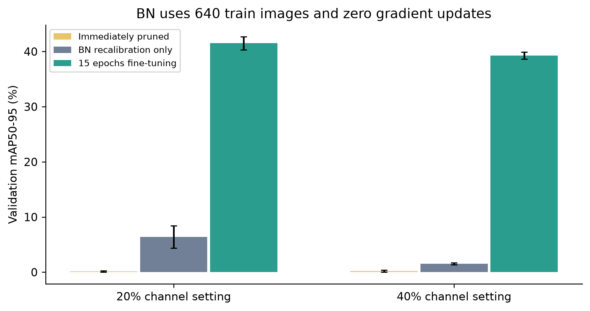

# 单机补充验证

这轮补充实验在查看原始测试结果后设计，属于探索性分析。归一化校准只读取训练图片，精度核对使用270张验证图。原18组测试结果与训练权重保持原样，补充结果没有冒充新一轮独立测试。

## 同一模型换一种运行方式

三个训练种子各测未融合、卷积/归一化融合和不同精度路径，共72组配置。每组预热20次、三轮各测40次，保存原始120次记录与P05/P95。CUDA计时前后同步；CPU为Intel Core i7-11800H（8核16线程），固定4个算子线程。模型计时不含预处理、NMS、读盘与绘图，完整流水线另有记录。下表单位为毫秒，除特别标注均为FP32，是每模型中位数再跨种子求均值。

| 条件 | GPU未融合 | GPU融合 | GPU融合FP16 | CPU融合 | CPU ONNX |
|---|---:|---:|---:|---:|---:|
| 未剪枝继续训练 | 6.11 | 4.33 | 5.10 | 20.07 | 8.68 |
| 轻度剪枝后微调 | 6.10 | 4.38 | 5.13 | 17.77 | 7.13 |
| 中度剪枝后微调 | 6.10 | 4.36 | 5.10 | 14.86 | 6.11 |

融合前后检查了12个模型的实际图片输出，均通过预先规定的容差。融合减少了运行时需要执行的归一化模块；其耗时变化有直接测量支持。FP16并未在当前单图、小模型路径中带来速度收益，不能把较低精度自动当成较快推理。这些结果仍受本机、线程、输入和后端限制。

## 归一化统计是否导致剪枝失效

每个模型只用固定640张训练图片重新计算BatchNorm均值与方差，20个batch，关闭增强，不反向传播。参数值的SHA256在前后完全一致，改变的是归一化统计。未剪枝继续训练模型也做相同处理，保留这一对照。

| 剪枝条件 | 立即剪枝 | 只重算BN | 15轮微调 |
|---|---:|---:|---:|
| 轻度剪枝后微调 | 0.14 | 6.38 | 41.50 |
| 中度剪枝后微调 | 0.19 | 1.53 | 39.24 |

表中为验证集mAP50-95百分数，三个种子的均值。重算统计能恢复一部分精度，仍远低于微调结果。因此当前证据不支持“只修正统计就能替代微调”。也不能把剪枝后的全部损失归结为单一原因。

未剪枝对照重算统计后，验证mAP50-95由43.65%变为42.73%。这项处理也不保证改善原模型。

## CPU独立运行时

另导出9个静态ONNX模型：三个种子乘三个已微调条件。输入固定为batch1、3通道、320×320，FP32，opset12。ONNX检查器完整检查通过；每个模型用14张真实验证图片核对原始输出，并在全部270张验证图上计算检测指标。这里复用相同的检测指标计算，网络推理由ONNX Runtime的CPUExecutionProvider完成，未调用GPU推理。

运行版本为ONNX1.17.0、ONNX Runtime1.20.1；算子线程4、算子间线程1，启用图优化。包及其PyPI哈希记录在onnx_package_manifest.json。额外依赖位于.onnx_deps，没有替换原训练环境。该验证证明本机CPU导出路径可用，不能代替另一台电脑或开发板验收。

## 来源和复核入口

- [PyTorch2.5.1的Conv/BN融合实现](https://github.com/pytorch/pytorch/blob/v2.5.1/torch/nn/utils/fusion.py)：读取后使用固定检测源码的fuse入口并核对输出。
- [PyTorch2.5.1的归一化统计更新参考](https://github.com/pytorch/pytorch/blob/v2.5.1/torch/optim/swa_utils.py)：本项目只把BN置为训练模式，保留检测头的评估行为；未运行SWA参数平均。
- [ONNX Runtime Python接口](https://onnxruntime.ai/docs/api/python/api_summary.html)和[线程设置](https://onnxruntime.ai/docs/performance/tune-performance/threading.html)。

原始文件：supplement_plan.json、supplement_timing.json、supplement_bn_validation.json、supplement_fp16_validation.json、onnx_validation_plan.json、onnx_validation.json及两份verification。配置在运行前保存，失败和不改善结果均保留。
